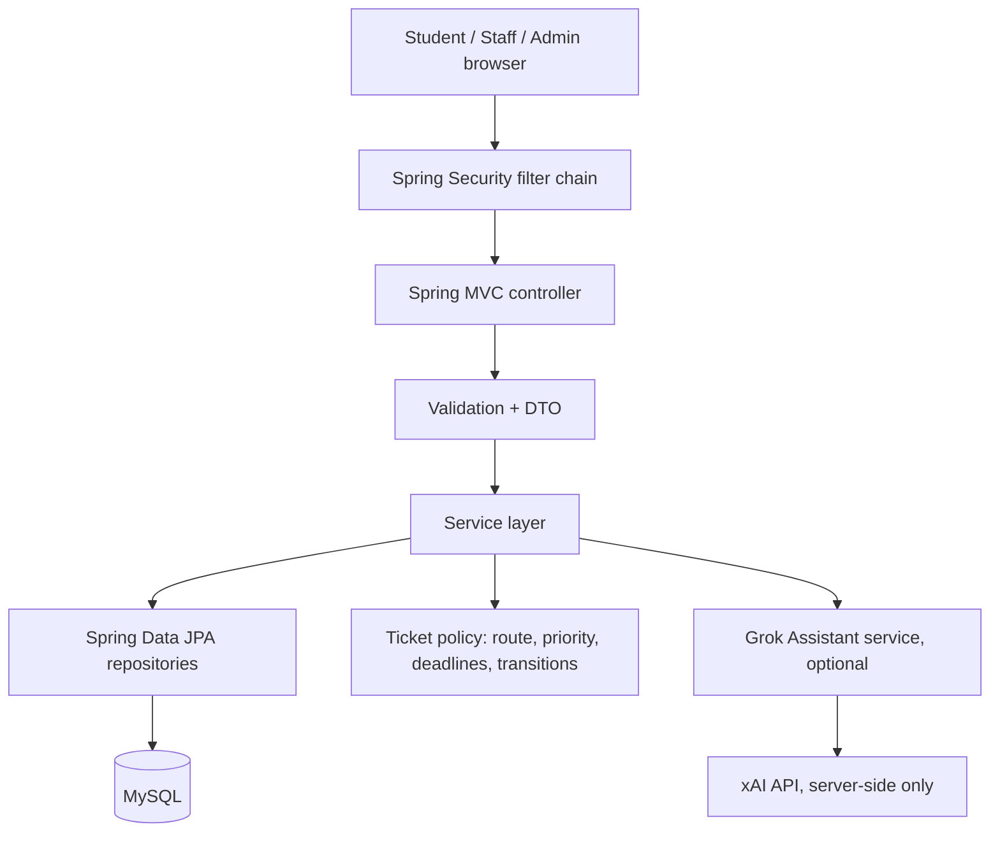

# CampusPulse AI architecture notes

## Request path

## Responsibility by layer

- **Controller:** binds web requests, validates input, chooses a template or redirect.
- **DTO:** accepts only permitted form fields and applies size/required constraints.
- **Service:** owns business rules, scope checks, ticket status transitions, and transactions.
- **Repository:** typed data access through Spring Data JPA.
- **Entity:** relational objects and their links.
- **Spring Security:** login session, password verification, role route restrictions, and CSRF protection.
- **TicketHistory:** records status changes with actor, prior/new state, timestamp, and note.
- **GrokAssistantService:** sends only the user question and approved FAQ context to xAI; no ticket records or identity data are attached.

## Priority and deadline rules

| Condition | Suggested priority | Target |
|---|---|---|
| Urgent campus-safety report | Critical | 4 hours |
| Urgent report, campus-wide impact, or many students affected | High | 24 hours |
| Soon or small-group impact | Medium | 72 hours |
| Routine individual issue | Low | 120 hours |

These are prototype defaults, not official university service-level commitments. The admin/institution should configure appropriate targets before real use.

## Ticket status transitions

- Submitted → Acknowledged, Assigned, Cancelled
- Acknowledged → Assigned, In progress, Cancelled
- Assigned → In progress, Cancelled
- In progress → Resolved, Assigned, Cancelled
- Resolved → Closed, Reopened
- Closed → Reopened
- Reopened → Assigned, In progress, Cancelled
- Cancelled → no further status transition

Transitions are checked in Java service logic; users cannot choose arbitrary states merely by editing a form submission.

## Data access policy

- Student: only their own tickets.
- Staff: tickets for their department or directly assigned to them.
- Admin: all tickets and user-role administration.
- Dashboard analytics are aggregate metrics and do not expose another student's ticket description.

## Future production improvements

1. Add Flyway/Liquibase migrations, constraints, and migration tests.
2. Replace seeded demo users with account invitation or verified registration workflows.
3. Add immutable admin audit events and account disable/reactivation controls.
4. Configure deadlines per category and staff schedules, not only suggested priority.
5. Add attachments through malware-checked object storage, notification delivery, and audit-safe retention.
6. Add integration tests using a disposable MySQL container and security tests for cross-user ticket access.
7. Add per-user AI rate limits, usage tracking, stronger prompt/data controls, and an explicit disclosure of provider processing.
